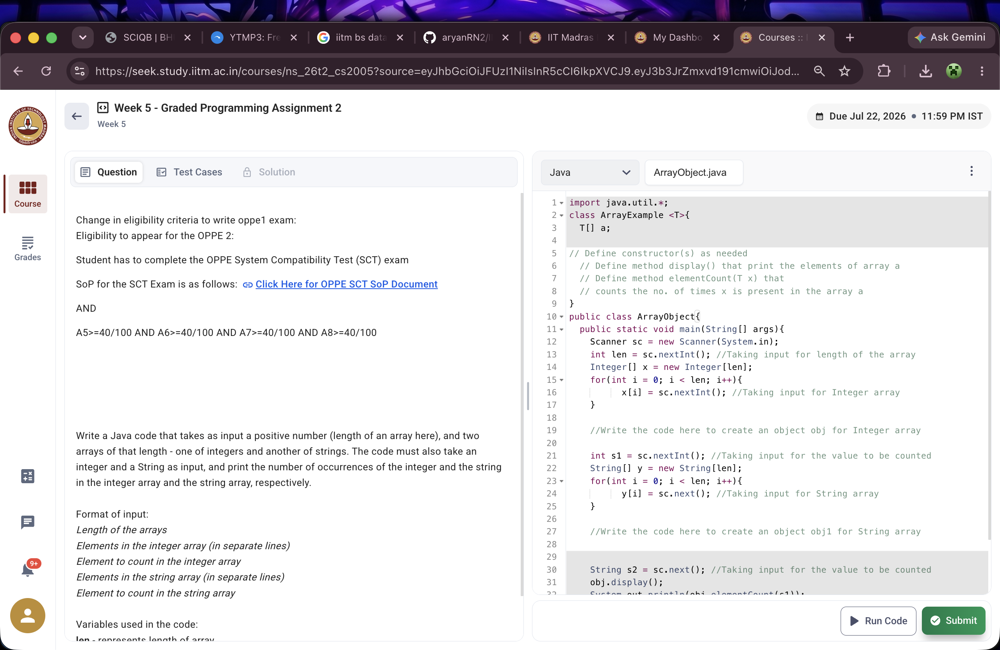

# IITM Graded Programming Assignment Bypass Guide

This repository contains working solution codes for the IITM BS Degree graded programming assignments, along with a console-based script to easily paste and inject your solutions directly into the coding portal (bypassing the copy-paste block).

---

## 🚀 How to Copy and Inject Code (Step-by-Step)

Follow these simple steps to inject your code into the IITM portal:

### Step 1: Copy the Console Command Script
Go to the folder of the week you want to solve, open the console command file, and copy the entire `document.querySelector` script. 

### Step 2: Open your IITM Assignment Portal
Log in and open your graded assignment page in Google Chrome.

---

### Step 3: Open the Developer Tools (Inspect)
To open the DevTools panel, you can use any of these easy methods:
* **Method 1:** Right-click anywhere on the page and select **Inspect**.
* **Method 2 (Keyboard Shortcut):**
  * **Mac:** Press `Cmd + Option + I` or `Cmd + Option + J`
  * **Windows/Linux:** Press `Ctrl + Shift + I` or `F12`

---

### Step 4: Go to the Console Tab
Once the developer panel opens:
1. Click on the **Console** tab at the top.
2. If you see the current dropdown set to something else, click on it and select **top** context to make sure scripts execute correctly.

---

### Step 5: Handling the Pasting Block Error (First-Time Users)
If this is your first time pasting code into the Chrome Console, Chrome will block it and show a warning message. 

To bypass this safety block:
1. Type `allow pasting` into the console input line.
2. Press **Enter**.
3. Now you will be able to paste any script into the console window.

---

### Step 6: Prepare the Portal Editor
Before running the console injection:
1. Go to the portal editor window.
2. **Delete all existing code** in the section where your solution needs to go. Ensure the section is clean and completely empty.
3. **Important:** Keep your text cursor active inside the blank white section of the code editor.

---

### Step 7: Inject the Code
Paste your copied console script into the Developer Console and hit **Enter**. The code will be instantly typed directly into the portal editor right where your cursor was active!

---

## 🛠️ Supported Course Assignments
* Java Programming (Week 2, 4, 5...)
* Python (Coming Soon)
* PDSA (Coming Soon)
* DBMS (Coming Soon)
* App Dev 1 & 2 (Coming Soon)

---
*Disclaimer: This repository is created for educational purposes to demonstrate browser Automation and JavaScript injection capabilities.*
